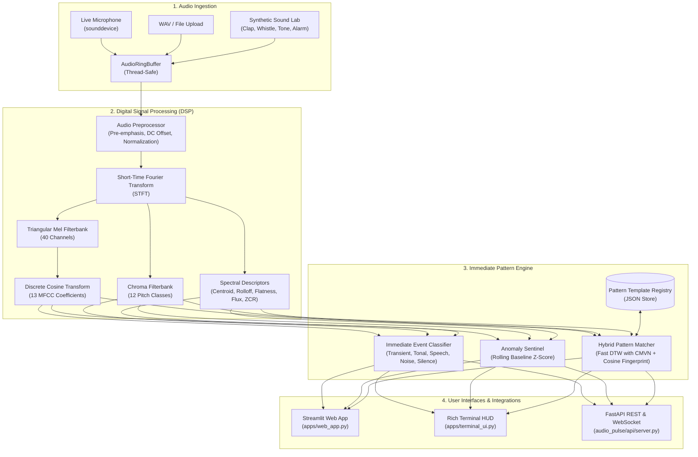

# 🔊 EchoPulse AI — Immediate Audio Pattern Recognition & Spectral Analysis Engine

[](https://www.python.org/)
[](https://fastapi.tiangolo.com)
[](https://streamlit.io)
[]()
[](LICENSE)

An industrial-grade, low-latency audio processing and pattern recognition system designed for **immediate acoustic event detection, spectral decomposition, dynamic template matching, and real-time anomaly monitoring**.

Built with pure, highly optimized **NumPy** and **SciPy** DSP algorithms, **EchoPulse** delivers sub-10ms response times per audio chunk without heavy binary dependencies or brittle wrappers.

---

## 🌟 Key Capabilities

- ⚡ **Immediate Real-Time Recognition (<10ms Latency)**: Continuously evaluates 50ms–100ms streaming audio frames with rolling circular ring buffers.
- 🎯 **Acoustic Event Detection (AED)**: Instant classification into:
  - `Transient / Impulse` (Claps, taps, clicks, percussion, door knocks)
  - `Tonal / Harmonic` (Whistles, pure sine tones, musical notes, beeps)
  - `Speech / Vocalization` (Formant frequencies, vocal tract resonances)
  - `Broadband Noise` (Hiss, fans, ventilation, airflow, background commotion)
  - `Silence / Ambient Baseline`
- 🧬 **Dynamic Time Warping (DTW) & Fingerprinting**:
  - Sequence alignment with **Cepstral Mean and Variance Normalization (CMVN)**.
  - Multi-feature acoustic fingerprinting combining MFCC, Chroma, Spectral Centroid, Rolloff, Crest Factor, and Flatness.
  - Template registry allowing user to register, store, and match custom sound patterns on the fly.
- 🚨 **Acoustic Anomaly Sentinel**: Tracks a rolling statistical baseline and flags sudden acoustic novelties, spikes, and unexpected harmonic shifts.
- 🎛️ **Dual User Interfaces**:
  - **Modern Streamlit Dashboard**: Dark-mode web interface with real-time gauges, interactive waveforms, Mel-spectrograms, MFCC heatmaps, and pattern library manager.
  - **Rich Terminal HUD (CLI)**: High-FPS terminal dashboard with live ASCII VU meters, vertical spectrum bars, and real-time alert badges.
- 🌐 **REST API & Bidirectional WebSocket**:
  - `/analyze/file` and `/analyze/chunk` for instant JSON feature and match responses.
  - `/ws/stream` WebSocket endpoint for continuous real-time audio chunk processing.
- 🧪 **Built-in Synthetic Sound Lab**: Generates pure tones, harmonic chords, whistles, chirps, handclaps, alarms, and noise for instant testing without needing an external microphone.

---

## 📐 System Architecture



---

## 📂 Repository Structure

```
ai-and-audio/
├── README.md                      # Comprehensive documentation
├── requirements.txt               # Project dependencies
├── pyproject.toml                 # Package configuration
├── setup.py                       # Pip installer
├── .gitignore                     # Git ignore rules
├── upload_to_github.py            # Automated GitHub upload & remote sync helper
├── push_to_github.bat             # One-click Windows batch script
│
├── audio_pulse/                   # Core Python Package
│   ├── __init__.py
│   ├── config.py                  # Global sampling, framing, and threshold configurations
│   ├── dsp/                       # Digital Signal Processing Core
│   │   ├── __init__.py
│   │   ├── features.py            # Complete feature extraction (MFCC, Chroma, Spectral, Time)
│   │   ├── filterbanks.py         # Pure NumPy Mel & Chroma filterbanks + STFT
│   │   └── preprocessor.py        # Normalization, DC removal, framing, pre-emphasis
│   ├── recognition/               # Pattern Recognition & Machine Learning
│   │   ├── __init__.py
│   │   ├── matcher.py             # Fast DTW & Cosine similarity pattern matcher
│   │   ├── classifier.py          # Immediate Acoustic Event Classifier
│   │   ├── anomaly.py             # Real-time acoustic anomaly & novelty detector
│   │   └── registry.py            # Acoustic template registry (store & load patterns)
│   ├── stream/                    # Streaming & Buffering
│   │   ├── __init__.py
│   │   ├── buffer.py              # Thread-safe circular audio ring buffer
│   │   ├── live_stream.py         # Sounddevice live microphone listener
│   │   └── simulated_stream.py    # Simulated real-time streaming player
│   ├── utils/                     # Utilities
│   │   ├── __init__.py
│   │   ├── audio_io.py            # WAV read, write, resample, and normalize
│   │   ├── synthetic_sounds.py    # Synthetic sound generator (tones, claps, sweeps, alarms)
│   │   └── visualizer.py          # Matplotlib 4-panel figures & ASCII terminal visualizers
│   └── api/                       # REST & WebSocket API
│       ├── __init__.py
│       └── server.py              # FastAPI server with WebSocket streaming
│
├── apps/                          # User Applications
│   ├── __init__.py
│   ├── web_app.py                 # Streamlit interactive Web Dashboard
│   └── terminal_ui.py             # Rich Terminal TUI / HUD
│
├── samples/                       # Pre-packaged Reference Audio Samples
│   ├── generate_samples.py        # Generates test audio files
│   └── *.wav                      # Hand clap, whistle chirp, 440Hz tone, siren, chord, noise
│
├── examples/                      # Demonstrations & Scripts
│   ├── quickstart.py              # 15-line quickstart script
│   └── batch_analyze.py           # Batch folder processor with JSON reports & PNG plots
│
└── tests/                         # Full Pytest Test Suite
    ├── __init__.py
    ├── test_dsp.py                # Tests DSP math, STFT, filterbanks, features
    ├── test_recognition.py        # Tests classifier, DTW matcher, anomaly sentinel
    ├── test_streaming.py          # Tests ring buffer and simulated stream
    └── test_api.py                # Tests FastAPI endpoints
```

---

## 🚀 Quickstart Guide

### 1. Installation

Clone or navigate to the repository directory and install dependencies:

```bash
# Clone the repository
git clone https://github.com/<your-username>/<your-repo-name>.git
cd "ai and audio"

# Install dependencies
pip install -r requirements.txt

# (Optional) Install in editable mode
pip install -e .
```

### 2. Generate Synthetic Test Samples

Generate pre-configured reference audio samples (WAV files) for testing:

```bash
python samples/generate_samples.py
```

### 3. Run the 15-Line Quickstart

```bash
python examples/quickstart.py
```

**Expected output:**
```
Registered reference template: 'Hand Clap' with 7717 samples.

[Immediate Event Detection]
Category:   Transient (Clap / Click / Beat)
Confidence: 100.0%
Summary:    Rapid onset and sharp peak characteristic of a clap, tap, or percussion hit.

[Pattern Match Results]
- Hand Clap: MATCH FOUND (Confidence: 84.6%, Distance: 1.7378)
```

---

## 🖥️ Running the Applications

### 🌐 1. Streamlit Web Dashboard

Launch the rich web dashboard with live audio meters, file inspector, and pattern registry:

```bash
streamlit run apps/web_app.py
```
Open your browser at `http://localhost:8501`.

**Features in Web App:**
- **Immediate Stream Analysis**: Inspect live or simulated sound frames with live VU meter, category predictions, anomaly alerts, and matching badges.
- **Audio File & Spectral Inspector**: Upload any WAV file to generate 4-panel spectral plots (Waveform, STFT, Mel-Spectrogram, MFCC heatmaps).
- **Sound Pattern Library**: Register new reference sound patterns, record custom fingerprints, and test sensitivity.
- **Synthetic Sound Lab**: Synthesize pure tones, musical chords, chirps, and claps interactively.

---

### 💻 2. Rich Terminal HUD (CLI)

Run the high-performance ASCII terminal visualizer:

```bash
# Simulated stream mode (works on any machine without mic)
python apps/terminal_ui.py --mode simulated

# Live microphone mode (requires audio input hardware)
python apps/terminal_ui.py --mode live

# Or stream a specific WAV file
python apps/terminal_ui.py --mode simulated --file samples/hand_clap.wav
```

---

### 🚀 3. REST & WebSocket API Server

Start the FastAPI server:

```bash
uvicorn audio_pulse.api.server:app --reload --host 0.0.0.0 --port 8000
```

- Interactive Swagger Docs: `http://localhost:8000/docs`
- Direct Chunk Analysis: `POST /analyze/chunk` (JSON array of audio samples)
- File Analysis: `POST /analyze/file` (multipart WAV upload)
- Real-Time Streaming: `WS /ws/stream`

---

### 📊 4. Batch Audio Analysis

Analyze an entire directory of audio files, produce structured JSON diagnostic reports, and export high-resolution PNG plots:

```bash
python examples/batch_analyze.py --input samples --output outputs/batch_run
```

---

## 🧪 Running the Test Suite

Run unit and integration tests with `pytest`:

```bash
python -m pytest tests/ -v
```

All 16 unit tests verify DSP mathematics, filterbank integrity, DTW alignment, anomaly detection, circular ring buffers, and API endpoints.

---

## 📤 Uploading to GitHub

This repository includes both an **interactive Python helper** (`upload_to_github.py`) and a **Windows batch script** (`push_to_github.bat`).

### Option A: Using the Automated Python Script
Run:
```bash
python upload_to_github.py
```
The script will prompt for your GitHub repository URL (e.g. `https://github.com/your-username/echopulse-audio.git`), configure your Git remote, and push the entire codebase.

### Option B: Using Git Command Line
```bash
# 1. Initialize git and commit
git init
git add .
git commit -m "Initial commit: EchoPulse AI Immediate Audio Pattern Recognition System"

# 2. Add your GitHub remote repository
git remote add origin https://github.com/<your-username>/<your-repo-name>.git

# 3. Rename branch to main and push
git branch -M main
git push -u origin main
```

---

## 📄 License

This project is licensed under the **MIT License** — free for personal, academic, and commercial use.

